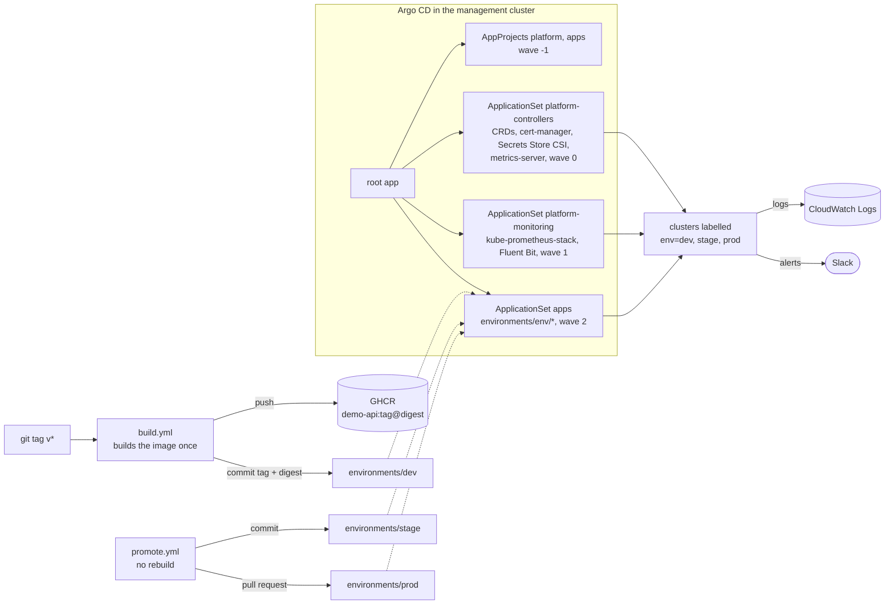

# argocd-platform-starter

[](https://github.com/QwertyUser17/argocd-platform-starter/actions/workflows/validate.yml)

## What it is and who it is for

A GitOps repository for Argo CD. It deploys a platform layer (CRDs, controllers, monitoring, logging) and apps to dev, stage and prod clusters. It also has the CI that builds an image once and promotes it from one environment to the next.

It's a reference implementation of a setup I've run in production. This repo is a personal project written from scratch: same ideas, none of the original code.

It's for a team with more than one environment, where a platform team owns the shared parts and app teams deploy their own services to the same clusters. One Argo CD in a management cluster manages all of them. With a single cluster it works too: just label that cluster `env=dev` (see "How to run"). The interesting part is "Decisions and why".

## Architecture



## Decisions and why

### Two layers, two projects
Platform and apps are separate AppProjects. The `apps` project can deploy only to `app-*` namespaces, and the only cluster-wide thing it can create is a Namespace with that name. The project name is written in the ApplicationSet template, not taken from generator parameters, so an app can't move itself into `platform`.

### One ApplicationSet per layer
Each layer is an ApplicationSet with a matrix generator: clusters with an `env` label, times components (`platform/*/*/component.yaml`) or app overlays (`environments/<env>/*`). To add a cluster, you register it with a label. To add a platform component, you add a folder. Applications are never written by hand.

### Sync waves that really wait
The root app deploys the layers in order: CRDs and controllers, then monitoring, then apps. But Argo CD marks an ApplicationSet healthy as soon as it has created its Applications, before they are synced. So I added a Lua health check in `bootstrap/argocd-values.yaml` that waits until every generated Application is Healthy. I didn't use Progressive Syncs because they turn off auto-sync, and then self-heal doesn't work.

### Self-heal everywhere, confirmed deletes for apps
Platform apps have automatic prune and self-heal. If something is removed from git it should be removed from the cluster too: a leftover webhook is worse than a deletion. Apps have self-heal too, but deletes wait for a confirmation (`Prune=confirm`). Many people edit app manifests, and a renamed overlay should not quietly delete a production Service or PVC.

Auto-prune can hurt the platform too. Once, while we were moving Grafana to a Helm chart, Argo CD synced the old app spec with auto-prune on and deleted Grafana in the middle of the move. Since then a big move starts with a separate commit that turns off auto-sync for that app.

### Retries read git again
Every Application has `retry.refresh: true`. In production I saw a sync start before the new spec arrived: it took the old chart version with the new values and kept retrying with that pair. With refresh, each retry uses the latest commit.

### Environments are overlays, not copies
`environments/<env>/demo-api` has only what is different: the image and the HPA limits (1-2 pods in dev, 2-4 in stage, 3-10 in prod). Platform charts have one `values.yaml` and a small `values-<env>.yaml` only where needed, for example for the `env` label on alerts or the log group name.

### Build once, promote by digest
A `v*` tag builds the image once. The build stops if the tag already exists, and it writes the tag and the digest to the dev overlay. `promote.yml` copies the same pair to stage with a commit and to prod with a pull request, without a rebuild. Pods run `tag@digest`, so prod gets exactly the image that was tested, and a rollback is a `git revert`.

### No secrets in git
The Slack webhook and the Grafana admin password are in AWS Secrets Manager. The Secrets Store CSI driver mounts them as files, and Pod Identity gives the pods access, so there are no role ARNs in the values either. IAM is created by `bootstrap/iam/setup.sh`. That's fine for a starter, but in production it belongs in Terraform.

### Logs go to CloudWatch
Fluent Bit sends container and kubelet logs to CloudWatch Logs, one log group per environment, kept for 14 days. I chose it over OpenSearch because there is no cluster to run, you pay only for the data. JSON logs are split into fields. Fluent Bit has a hard 128Mi memory limit, and its inputs stop at 5MB of buffer instead of growing until OOM.

### Alerts
On top of the kube-prometheus-stack defaults:
- OOM kills;
- CrashLoopBackOff;
- containers stuck in waiting for 15 minutes (image pull errors, a missing Secret);
- NodeNotReady;
- containers without a memory limit, only in `app-*`, because some platform DaemonSets run without one on purpose.

I turned off the default CrashLoop and NodeNotReady rules, so Slack doesn't get each alert twice. Every alert shows the environment.

### No CPU limits
Pods get a CPU request and a memory limit, but no CPU limit. A CPU limit throttles a container even when the node has free CPU, and the request already gives the pod its share when CPU is busy. The "Requests vs usage" dashboard in Grafana shows requests next to p95 CPU and peak memory for each container, like KRR does, so you can set requests from real numbers.

p95 is only a starting point. In production some services with short CPU spikes were throttled at peaks, so for them I set the CPU request from the maximum (p100) instead.

### CI renders what Argo CD would apply
`scripts/render.sh` renders every Application the way Argo CD does:
- the same value files;
- the same Helm version as the Argo CD release;
- CRDs included.

Then CI checks the output:
- kubeconform against Kubernetes and the rendered CRDs;
- promtool for the alert rules;
- amtool for the Alertmanager config;
- `fluent-bit --dry-run` for the logging config.

promtool, amtool and Fluent Bit run from the same images that get deployed. Renovate updates charts and tools. Only low-risk updates merge by themselves, and only after this check passes.

## Things I'm not sure about

- There is one root app for all clusters, and the Lua check waits for all of them. If one app in prod is Degraded, the apps wave waits in dev and stage too. I'm not sure that's better than one root app per cluster.
- `fluent-bit --dry-run` catches syntax errors and unknown keys, but not a parser name that doesn't exist. I found that out while testing, so this CI check would let it through.

## How to run

You need a management cluster for Argo CD and one or more EKS clusters for workloads, with the EKS Pod Identity Agent add-on. They can all be the same cluster.

If you fork the repo, first replace `QwertyUser17/argocd-platform-starter` and `ghcr.io/qwertyuser17` everywhere.

1. In each workload cluster's account, create two secrets in Secrets Manager: `platform/monitoring/slack-webhook-url` and `platform/monitoring/grafana-admin-password`.

2. Create the IAM roles and Pod Identity associations:

   ```bash
   bootstrap/iam/setup.sh <cluster-name> <region>
   ```

3. Install Argo CD and the root app. The script needs an explicit kube context, so it can't install into whatever cluster is current:

   ```bash
   bootstrap/install.sh <kube-context>
   ```

4. Register the workload clusters with an `env` label:

   ```bash
   argocd cluster add <kube-context> --label env=stage
   ```

   For a single cluster, label the cluster where Argo CD runs:

   ```yaml
   apiVersion: v1
   kind: Secret
   metadata:
     name: in-cluster
     namespace: argocd
     labels:
       argocd.argoproj.io/secret-type: cluster
       env: dev
   stringData:
     name: in-cluster
     server: https://kubernetes.default.svc
     config: '{"tlsClientConfig":{"insecure":false}}'
   ```

5. Push a `v0.1.0` tag to build the first image. Then make the `demo-api` package public in GHCR, or give the clusters a pull secret.

6. Promote in GitHub Actions: workflow "promote", target `stage` or `prod`. For the prod pull request, turn on "Allow GitHub Actions to create and approve pull requests" in the repository settings.

To check a change before pushing, run `scripts/render.sh /tmp/rendered`. It needs Helm and kubectl.

## What I would add in production

- A `deploy` branch for Argo CD that CI moves forward only after the checks pass, so clusters never see an unchecked commit. It needs a GitHub App or a PAT, because commits made with `GITHUB_TOKEN` don't start other workflows.
- IAM roles, Pod Identity associations and Secrets Manager entries in Terraform instead of a script.
- SSO for Argo CD, with IdP groups mapped to the `platform-team` and `app-developers` project roles, and Argo CD notifications.
- Admission policies instead of alerts: ValidatingAdmissionPolicy or Kyverno to require memory limits and block `:latest`.
- Persistent storage for Prometheus, long-term metrics in Amazon Managed Prometheus or Thanos, and Grafana behind SSO.
- Default-deny NetworkPolicies in `app-*` namespaces.
- Image signing with cosign and a check at admission.
- App manifests in the teams' own repositories, found by an SCM provider generator.
